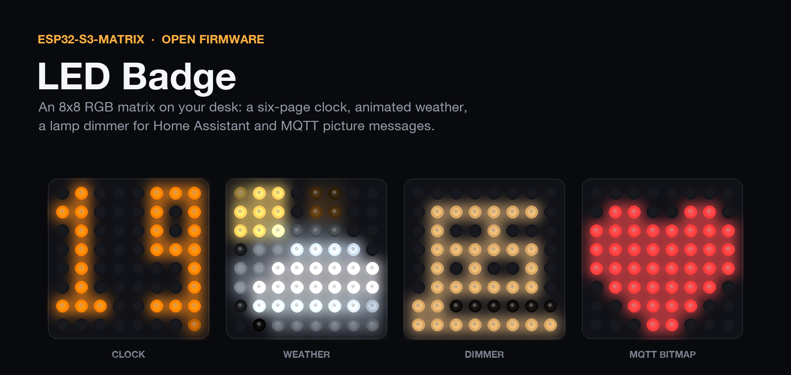
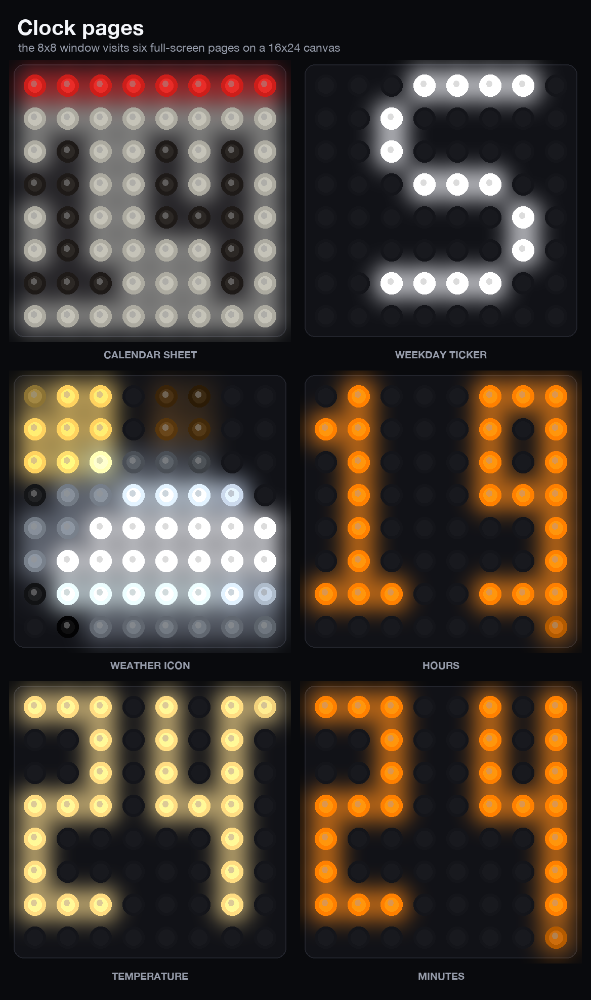
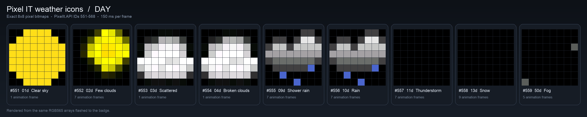
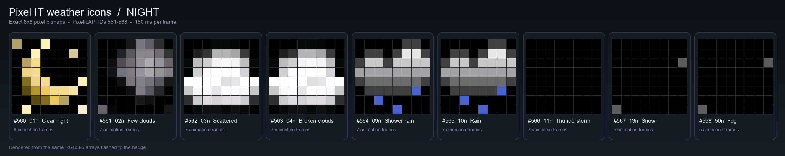
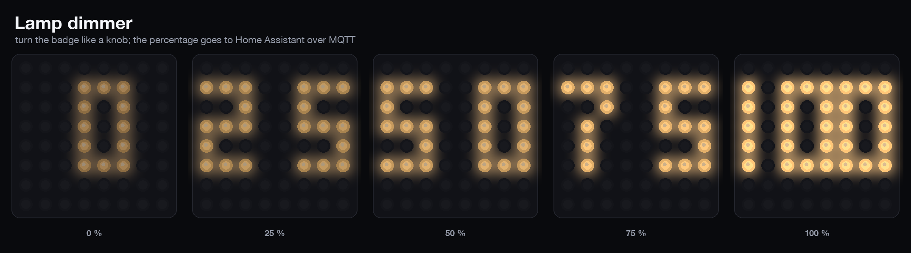
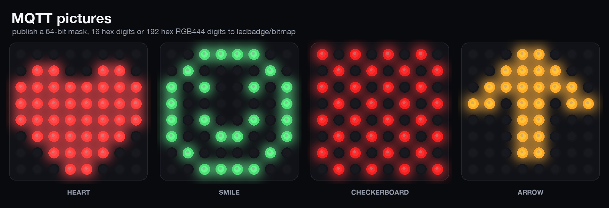

# LED Badge



Firmware for the **Waveshare ESP32-S3-Matrix** — a tiny ESP32-S3 board with an
8×8 RGB LED matrix, a six-axis IMU and a BOOT button. This repository contains
two complete Arduino sketches for it:

| Sketch | What it does |
|---|---|
| [**ESP32_S3_Matrix_Liquid**](firmware/ESP32_S3_Matrix_Liquid/) | A six-page clock with live weather and exact Pixel IT icons, a tear-off calendar, a scrolling weekday, a lamp dimmer for Home Assistant, MQTT messages and 8×8 pictures. |
| [**ESP32_S3_Matrix_Digital_Level**](firmware/ESP32_S3_Matrix_Digital_Level/) | A digital spirit level: the matrix becomes a smooth bubble level with single-axis, dual-axis and digital-angle modes. Ported from [SMDVIBE's ESP32 Digital Spirit Level](https://github.com/SMDVIBE/ESP32-Digital-Spirit-Level). |

Both sketches are flashed to the same board; pick one. The clock sketch is the
main project here.

## What the badge can do

- **Clock** — a 16×24 virtual canvas visited by an 8×8 window that glides
  between six full-screen pages: hours, minutes, temperature, animated weather
  icon, tear-off calendar sheet and a scrolling weekday.
- **Weather** — current conditions from Open-Meteo (temperature, weather code,
  day/night), refreshed every 15 minutes. Seven icon kinds, each with a day and
  a night variant.
- **Night-only clock** — during the night window the badge shows just hours and
  minutes; weather, temperature, date and weekday come back in the morning.
  It uses the same two times as the brightness schedule and can be enabled
  independently of it.
- **Matrix off switch** — brightness `0` turns the matrix off completely, even
  when the day/night schedule is on; `1` is the faintest visible level.
- **Lamp dimmer** — double-click BOOT and the badge becomes a rotary dimmer
  for a real lamp: turn it upright or spin it flat on the table, and the angle
  is published to MQTT for Home Assistant to drive a smart bulb.
- **MQTT** — scrolling text messages, retained availability, and full Home
  Assistant discovery (Wi-Fi, IP, uptime, memory, brightness, knob, message and
  an 8×8 picture entity).
- **MQTT pictures** — publish a 64-bit mask, 16 hex digits or a full-colour
  192-hex-digit image to draw any 8×8 picture.
- **Web settings** — change Wi-Fi, time zone, weather city, colours,
  brightness, the day/night schedule, MQTT and the BLE bridge from a phone. If
  the saved network disappears, the badge opens its own setup hotspot.
- **Upright picture** — the accelerometer rotates the frame in 90° steps, so
  the badge reads correctly however you hold it.

## Gallery

### Six clock pages

The 8×8 window visits a 16×24 canvas one screen at a time, gliding between the
pages with a smoothstep ease. The calendar sheet and the weekday ticker move as
one continuous strip with a one-pixel gap between them.

[](docs/images/clock-pages.png)

### Weather icons

The clock uses the **exact 8×8 animated icons from Pixel IT** — the OpenWeather
bitmaps that Home Assistant / Node-RED send to those displays. They are stored
verbatim in `pixelit_icons.h` (PixelIt.API IDs 551–568), drawn in their original
RGB565 colours and advanced every 150 ms, just like on the original clock. A
separate day and night bitmap is used for every condition.

[](docs/images/weather-day.png)

[](docs/images/weather-night.png)

### Lamp dimmer

[](docs/images/dimmer.png)

### MQTT pictures

Publish any 8×8 bitmap to `ledbadge/bitmap` — a heart, a smiley, a
checkerboard, an arrow, or something you generate yourself.

[](docs/images/mqtt-bitmap.png)

> The images above are rendered from the same drawing code the firmware runs,
> so they show the real pixel layout and colours.

## Hardware

| Item | Value |
|---|---|
| Board | Waveshare ESP32-S3-Matrix (SKU 27119), ESP32-S3, 4 MB flash / 2 MB PSRAM |
| LED matrix | 8×8 WS2811, data on **GPIO14**, 64 LEDs |
| IMU | QMI8658, I²C address `0x6B`, SDA **GPIO11**, SCL **GPIO12** |
| Button | BOOT on **GPIO0** (active low) |
| USB | USB-C, native USB CDC serial |

## Repository layout

```
.
├── firmware/
│   ├── ESP32_S3_Matrix_Liquid/          clock, weather, dimmer, MQTT
│   │   ├── ESP32_S3_Matrix_Liquid.ino
│   │   └── README.md                    full documentation and tuning guide
│   └── ESP32_S3_Matrix_Digital_Level/   spirit level
│       ├── ESP32_S3_Matrix_Digital_Level.ino
│       └── README.md
├── docs/images/                         previews used by this README
└── README.md
```

## Build and flash

### Libraries

Install the ESP32 board support (`esp32:esp32`, tested with 3.3.x) and these
Arduino libraries:

```bash
arduino-cli lib install Adafruit_NeoPixel PubSubClient NimBLE-Arduino
```

The spirit level only needs **Adafruit_NeoPixel**.

### Arduino IDE

1. Open `firmware/ESP32_S3_Matrix_Liquid/ESP32_S3_Matrix_Liquid.ino`.
2. Select **ESP32S3 Dev Module**.
3. Set **USB CDC On Boot: Enabled** (for the serial console).
4. Set **Partition Scheme: Minimal SPIFFS** — the clock sketch is larger than
   the default 1.2 MB app partition.
5. Upload.

### arduino-cli

```bash
# clock
arduino-cli compile --fqbn "esp32:esp32:esp32s3:CDCOnBoot=cdc,PartitionScheme=min_spiffs" \
  firmware/ESP32_S3_Matrix_Liquid
arduino-cli upload  --fqbn "esp32:esp32:esp32s3:CDCOnBoot=cdc,PartitionScheme=min_spiffs" \
  --port /dev/cu.usbmodem14201 firmware/ESP32_S3_Matrix_Liquid

# spirit level (fits the default partition; CDC is optional)
arduino-cli compile --fqbn "esp32:esp32:esp32s3:CDCOnBoot=cdc" \
  firmware/ESP32_S3_Matrix_Digital_Level
```

Expected clock boot log:

```
LED BADGE BOOT
QMI WHO_AM_I=0x5
EFFECT: clock
COLOUR: red
WIFI: connecting to [YOUR_WIFI_SSID]
WEB: settings page listening on port 80
WIFI: ok, IP 192.168.1.50
```

### First start / Wi-Fi

The sketch ships with placeholders:

```cpp
#define CLOCK_WIFI_SSID   "YOUR_WIFI_SSID"
#define CLOCK_WIFI_PASS   "YOUR_WIFI_PASSWORD"
```

Either edit those two lines before flashing, or leave them and use the setup
hotspot: after about 35 seconds the badge starts a `LedBadge-XXXX` access point
(password `ledbadge`). Connect to it and open <http://192.168.4.1/> to enter
your network. The credentials are stored in NVS; nothing needs to be reflashed
when you move to another Wi-Fi.

## Controls (clock sketch)

| Action | Effect |
|---|---|
| Single click **BOOT** | next base colour |
| Double click **BOOT** | switch effect: clock → lamp dimmer → clock |
| Hold **BOOT** (≥ 0.5 s) | animation dynamics 50 → 200 %, then back down |
| Turn the badge upright / flat | dimmer percentage (accelerometer + gyro) |
| Web page | Wi-Fi, time zone, city, colours, brightness, MQTT, BLE |

Colour order: red → orange → yellow → green → cyan → blue → violet → magenta.
Settings and the current colour, effect, dynamics and brightness survive a
reboot (NVS).

## Web settings page

Open `http://<badge-ip>/` from any device on the same network. You can change:

- Wi-Fi network and password (blank password keeps the current one);
- time zone (list of common POSIX zones plus a custom entry);
- weather city, or locate automatically by public IP;
- hour/minute colour and temperature colour (fixed or automatic by value);
- manual brightness (`0` = matrix off) and an optional day/night schedule,
  including a night-only "time only" mode;
- MQTT broker, username, password and message topic;
- the BLE advertisement relay and optional Home Assistant sensors.

## Home Assistant

### MQTT discovery

Enable MQTT on the web page and the badge announces itself under
`homeassistant/<component>/ledbadge_XXXXXX/…`. A single **LED Badge** device
appears in Home Assistant with these entities:

| Entity | Type | Topic |
|---|---|---|
| Wi-Fi signal | sensor (dBm) | `ledbadge/state` → `wifi` |
| IP address | sensor | `ledbadge/state` → `ip` |
| Uptime | sensor (s) | `ledbadge/state` → `uptime` |
| Free memory | sensor (B) | `ledbadge/state` → `heap` |
| Brightness | number, 1–255 | `ledbadge/bright/set` / `ledbadge/bright` |
| Knob | sensor (%) | `ledbadge/knob` → `pct` |
| Message | text, max 160 | `ledbadge/text` |
| Bitmap 8x8 | text, max 205 | `ledbadge/bitmap` |

The node id comes from the chip MAC, so nothing is tied to a particular
network. The state snapshot is retained and refreshed every 15 s.

### Scrolling text

```bash
mosquitto_pub -h 192.168.1.50 -t ledbadge/text -m "Dinner is ready"
```

The text scrolls right-to-left in any effect, is folded to upper case and is
capped at 160 characters. A Home Assistant automation can publish to the same
topic, or use the **Message** text entity directly.

### 8×8 pictures

Publish to **`ledbadge/bitmap`**. The picture appears immediately, overrides
the clock or the scrolling text for the chosen time (20 s by default), then the
effect resumes. Whitespace, including line breaks, is ignored.

| Body | Meaning |
|---|---|
| 64 characters of `0`/`1` | monochrome mask, row-major, top-left first |
| 16 hex digits | the same mask as 8 row bytes, MSB = left pixel |
| 192 hex digits | full colour, 3 hex digits per pixel (`RGB444`, 64 × 3) |

Optional suffixes: `:<RRGGBB>` (or `:#RRGGBB`) sets the colour of a monochrome
mask, and `:<seconds>` sets how long it stays (`0` = until replaced or
cleared). An empty payload, `off` or `clear` removes the picture.

```bash
# heart mask as hex, orange, one minute
mosquitto_pub -h 192.168.1.50 -t ledbadge/bitmap -m "0066FFFFFF7E3C18:FF8800:60"

# the same heart as 64 bits, white, 20 seconds
mosquitto_pub -h 192.168.1.50 -t ledbadge/bitmap \
  -m "000000000110011011111111111111111111111101111110001111000001100000000000"

# sticky until cleared
mosquitto_pub -h 192.168.1.50 -t ledbadge/bitmap -m "0066FFFFFF7E3C18:FFFFFF:0"

# clear now
mosquitto_pub -h 192.168.1.50 -t ledbadge/bitmap -m "off"
```

A full-colour image is 64 pixels × 3 hex digits = 192 characters. A red/black
checkerboard starts `F00000F00000…` (`F00` = red, `000` = black). The picture
follows the accelerometer orientation, exactly like the clock.

### Lamp dimmer

The badge publishes `{"pct":N}` to `ledbadge/knob` while you turn it. Map that
to your lamp in Home Assistant:

```yaml
alias: Badge knob to lamp
trigger:
  - platform: mqtt
    topic: ledbadge/knob
action:
  - service: light.turn_on
    target:
      entity_id: light.desk_lamp
    data:
      brightness_pct: "{{ trigger.payload_json.pct }}"
```

The knob is absolute (the accelerometer provides the angle, so it does not
drift); on a flat surface the gyro takes over. Full details are in the
[firmware README](firmware/ESP32_S3_Matrix_Liquid/README.md).

## Spirit level

The second sketch turns the same board into a smooth digital bubble level:
two-axis and single-axis modes, a bubble rendered with bilinear sub-pixel
weights, a digital angle readout, independent zero calibration per mode and a
sensor watchdog. See the
[spirit-level README](firmware/ESP32_S3_Matrix_Digital_Level/README.md) for
the register map, modes and calibration procedure.

## Notes

- **Brightness** — the matrix is bright and runs warm. The firmware defaults
  are conservative; do not push all 64 LEDs to full white for long periods.
  A manual brightness of `0` powers the matrix off and overrides the schedule.
- **Weather demo** — set `WEATHER_DEMO 1` at the top of the clock sketch to
  cycle all 14 weather icons full screen (day and night). It is `0` in the
  shipped build. `WEATHER_DEMO_MS` sets the frame time (2 s).
- **Serial debug** — `DEBUG_KNOB` must stay `0` in stand-alone use: a blocking
  `Serial.print` into a full USB-CDC buffer with no monitor attached freezes
  the animation.
- **No credentials in this repository** — Wi-Fi, broker and location details
  are placeholders or generic examples. Configure your own on the web page.

## Acknowledgements

The spirit-level sketch is a port of
[SMDVIBE/ESP32-Digital-Spirit-Level](https://github.com/SMDVIBE/ESP32-Digital-Spirit-Level),
originally built for an ESP32-C3 with an ST7789 display and an MPU-6050. This
port keeps its measurement logic and calibration scheme and replaces the
hardware layer with the ESP32-S3-Matrix peripherals.

Weather data by [Open-Meteo](https://open-meteo.com/). Time from NTP.
